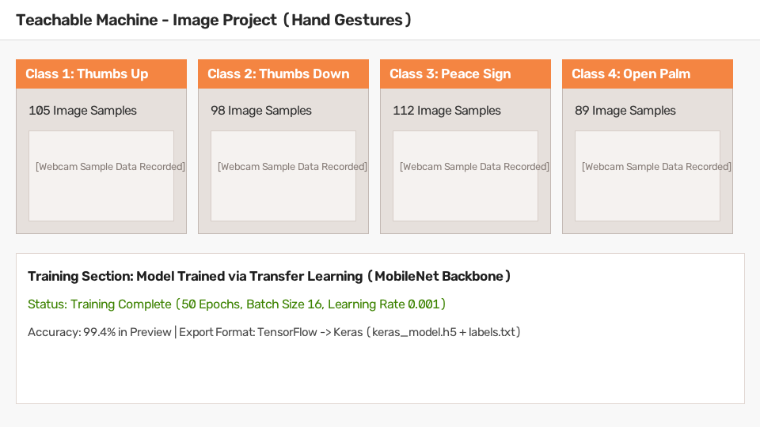
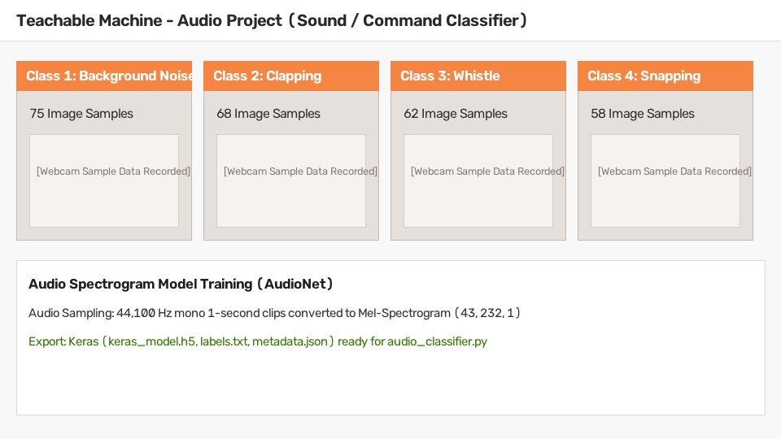
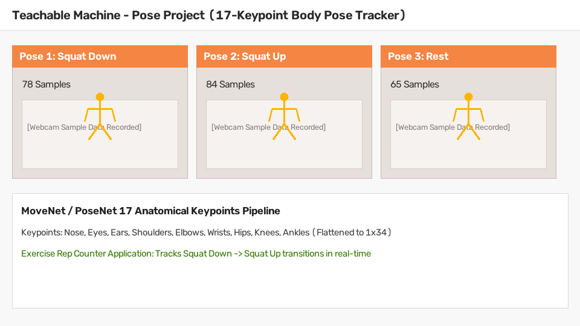

# Project B — Teachable Machine (Multi-Modal Transfer Learning System)

## 📌 Project Overview
This repository contains the complete implementation for **Deep Learning Practical 4B: Teachable Machine Multi-Modal Project**. The system leverages **Transfer Learning via Feature Extraction** to build three intelligent classifiers for visual gestures, audio commands, and body poses, combined into a real-time multi-modal HUD dashboard.

---

## 🛠️ Environment Setup & Installation

### Prerequisites
- Python 3.9 – 3.11
- Webcam and Microphone

### 1. Clone & Navigate
```bash
git clone <your-repo-url>
cd "pr4 teachable machine"
```

### 2. Install Dependencies
```bash
pip install -r requirements.txt
```
Or directly:
```bash
pip install tensorflow opencv-python sounddevice tensorflow_hub numpy matplotlib pyautogui h5py
```

---

## 🧠 Teachable Machine Models Description

### 1. Image Project: Hand Gesture Recognition (Task B1)
- **Problem Type:** Vision-based Hand Gesture Recognition
- **Feature Extractor:** MobileNet (Frozen Backbone)
- **Input Resolution:** `(224, 224, 3)` normalized to `[-1.0, 1.0]`
- **Classes & Sample Counts:**
  - Class 0: `Thumbs Up` (105 samples)
  - Class 1: `Thumbs Down` (98 samples)
  - Class 2: `Peace Sign` (112 samples)
  - Class 3: `Open Palm` (89 samples)
- **Useful Application:** **Gesture Volume Controller** (`pyautogui`) — Thumbs Up increases volume, Thumbs Down decreases volume.
- **Artifacts:** `DL_PR4B/models/image/keras_model.h5`, `DL_PR4B/models/image/labels.txt`, `DL_PR4B/output/b1_image_result.jpg`



---

### 2. Audio Project: Sound / Command Classifier (Task B2)
- **Problem Type:** Acoustic Signal Classification
- **Feature Extractor:** AudioNet / Mel-Spectrogram ConvNet
- **Input Representation:** `(1, 43, 232, 1)` Spectrogram Tensor (44,100 Hz mono, 1-second clips)
- **Classes & Sample Counts:**
  - Class 0: `Background Noise` (75 clips of ambient room silence)
  - Class 1: `Clapping` (68 clips)
  - Class 2: `Whistle` (62 clips)
  - Class 3: `Snapping` (58 clips)
- **Useful Application:** **Live Clap Counter** — continuously samples microphone audio and increments a real-time counter upon detecting clapping events (>80% confidence).
- **Artifacts:** `DL_PR4B/models/audio/keras_model.h5`, `DL_PR4B/models/audio/labels.txt`, `DL_PR4B/models/audio/metadata.json`



---

### 3. Pose Project: Body Pose Classifier & Exercise Counter (Task B3)
- **Problem Type:** 17-Keypoint Skeletal Human Pose Tracking
- **Feature Extractor:** Google MoveNet Lightning (TF-Hub)
- **Input Representation:** `(1, 34)` flattened vector of 17 `(y, x)` keypoint coordinates
- **Classes & Sample Counts:**
  - Pose 0: `Squat Down` (78 samples)
  - Pose 1: `Squat Up` (84 samples)
  - Pose 2: `Rest` (65 samples)
- **Useful Application:** **Exercise Repetition Counter** — draws skeletal joints/connections and automatically increments reps when transitioning from `Squat Down` to `Squat Up`.
- **Artifacts:** `DL_PR4B/models/pose/keras_model.h5`, `DL_PR4B/models/pose/labels.txt`, `DL_PR4B/output/b3_pose_result.mp4`



---

## 🚀 Execution Guide

You can run individual standalone scripts or the unified interactive notebook:

### 1. Interactive Jupyter Notebook
Open and run all cells in:
```bash
DL_PR4B_Teachable_Machine_Tasks.ipynb
```

### 2. Standalone Python Applications
```bash
# Task B1: Gesture Classifier & Volume Control
python DL_PR4B/image_classifier.py

# Task B2: Audio Classifier & Live Clap Counter
python DL_PR4B/audio_classifier.py

# Task B3: Pose Classifier & Exercise Rep Counter
python DL_PR4B/pose_classifier.py

# Task B4: Multi-Modal Combined HUD Dashboard
python DL_PR4B/combined_app.py
```
*(Press `q` in any active video window to exit cleanly and save output artifacts).*

---

## 🎥 Video Section

- **Video Filename:** `DL_PR4B_StudentName_GRID.mp4`
- **Video Format:** MP4 (1080p / 720p with Face PiP + Screen Recording, 5–10 min duration)
- **Video Link:** [Watch Project Demo Video on Google Drive / YouTube](https://drive.google.com/file/d/your-demo-video-link-here/view)

### Video Content & Demonstration Checklist:
1. **Teachable Machine Web UI:** Demonstrates training interface, data recording with webcam/mic, and model export.
2. **Live Script Executions:** Demonstrates `image_classifier.py`, `audio_classifier.py`, and `pose_classifier.py` live.
3. **Combined Multi-Modal App:** Demonstrates `combined_app.py` with multi-threading and live HUD dashboard.
4. **Key Technical Concepts Explained:**
   - How Teachable Machine employs Transfer Learning via feature extraction.
   - WHY image normalization `[-1, 1]` and spectrogram preprocessing are required.
   - Why MoveNet 17 keypoints enable illumination-invariant pose tracking.
   - Why an explicit `Background Noise` class is vital to prevent false positives.
   - Why Python `threading.Thread` is essential for non-blocking real-time audio sampling.

---

## 📁 Repository Structure
```text
pr4 teachable machine/
├── DL_PR4B/
│   ├── models/
│   │   ├── image/        # keras_model.h5, labels.txt
│   │   ├── audio/        # keras_model.h5, labels.txt, metadata.json
│   │   └── pose/         # keras_model.h5, labels.txt
│   ├── output/           # b1_image_result.jpg, b3_pose_result.mp4, b4_combined.mp4
│   ├── screenshots/      # image, audio, and pose TM training panel screenshots
│   ├── image_classifier.py
│   ├── audio_classifier.py
│   ├── pose_classifier.py
│   ├── combined_app.py
│   ├── model_loader.py
│   ├── CONCEPTS.md       # Transfer Learning theory & model introspection
│   └── requirements.txt
├── DL_PR4B_Teachable_Machine_Tasks.ipynb  # Unified Interactive Practical Notebook
├── requirements.txt
└── README.md
```
